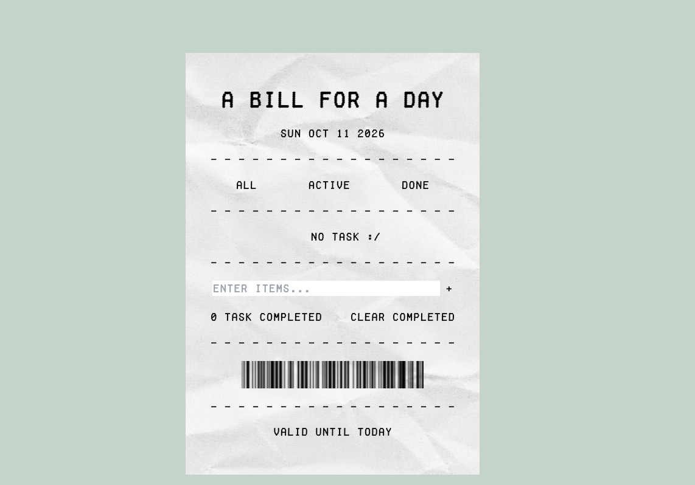

# A Bill for a Day

영수증 디자인으로 하루의 할 일을 정리하는 목록입니다. 할 일은 브라우저에 저장됩니다.



## 목차

- [A Bill for a Day](#a-bill-for-a-day)
  - [목차](#목차)
  - [프로젝트 소개](#프로젝트-소개)
  - [주요 기능](#주요-기능)
  - [버튼 설명](#버튼-설명)
  - [사용 기술](#사용-기술)
  - [로컬에서 실행하기](#로컬에서-실행하기)
  - [폴더 구조](#폴더-구조)

## 프로젝트 소개

시간은 돈처럼 소중하게 써야 한다는 생각에서 시작했습니다. 영수증에 하루의 지출을 적듯, 오늘의 할 일을 정리하고 완료한 일을 확인할 수 있도록 만들었습니다.

돼지저금통 모양의 파비콘에는 시간을 돈처럼 아껴 차곡차곡 모으자는 뜻을 담았습니다. 작은 할 일을 하나씩 끝내며 오늘을 알차게 보내자는 의미입니다.

## 주요 기능

- 할 일을 추가하고, 수정하고, 삭제할 수 있습니다.
- 할 일의 완료 여부를 표시할 수 있습니다.
- 전체, 진행 중, 완료된 할 일만 골라 볼 수 있습니다.
- 완료된 할 일을 한 번에 삭제할 수 있습니다.
- 할 일은 브라우저의 `localStorage`에 저장됩니다.
- 오늘 날짜와 완료한 할 일 수를 보여줍니다.

## 버튼 설명

| 화면에 보이는 것  | 하는 일                              |
| ----------------- | ------------------------------------ |
| `All`             | 모든 할 일을 보여줍니다.             |
| `Active`          | 아직 끝내지 않은 할 일을 보여줍니다. |
| `Done`            | 끝낸 할 일을 보여줍니다.             |
| 체크박스          | 할 일의 완료 상태를 바꿉니다.        |
| `+`               | 입력한 할 일을 목록에 추가합니다.    |
| `E`               | 해당 할 일의 내용을 고칩니다.        |
| `x`               | 해당 할 일을 삭제합니다.             |
| `clear completed` | 끝낸 할 일을 모두 삭제합니다.        |

## 사용 기술

- HTML
- CSS
- JavaScript
- Tailwind CSS 3

## 로컬에서 실행하기

필요한 CSS 파일이 포함되어 있습니다. 저장소의 최상위 폴더에서 아래 명령어를 실행하세요.

```sh
cd mjlee
python3 -m http.server 8000
```

그다음 브라우저에서 <http://localhost:8000>을 여세요.

## 폴더 구조

```text
.
├── assets/          # 영수증 배경, 바코드 이미지, 파비콘, 글꼴
├── css/
│   ├── style.css
│   ├── tailwind-input.css
│   └── tailwind.css
├── js/
│   └── todo.js
├── index.html
└── main.png         # README 미리 보기 이미지
```
